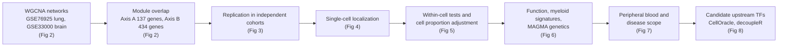

# COPD lung and Alzheimer's disease brain co-expression analysis

[](LICENSE)


Analysis code for the article

> **Co-expression network analysis of chronic obstructive pulmonary disease lung and Alzheimer's disease brain reveals a shared myeloid gene program enriched for Alzheimer's disease genetic risk**
> Feijie Yao (PLOS ONE submission)

All inputs are public. The only study-generated data are the fixed Axis A (137 genes) and Axis B (434 genes) lists in [`resources/`](resources/) (also Table B in S2 File) and the plotted values in S1 Data and [`manuscript/main_figures/source_data/`](manuscript/main_figures/source_data/).

## Two ways to find the code

| By analysis | By figure |
| --- | --- |
| [`scripts/`](scripts/) holds the core pipeline by analysis step, and [`analyses/`](analyses/) holds one folder per further analysis. See [Code by analysis](#code-by-analysis). | [`by_figure/`](by_figure/README.md) has one page per figure, panels in order: [Fig 1](by_figure/Fig1.md) · [Fig 2](by_figure/Fig2.md) · [Fig 3](by_figure/Fig3.md) · [Fig 4](by_figure/Fig4.md) · [Fig 5](by_figure/Fig5.md) · [Fig 6](by_figure/Fig6.md) · [Fig 7](by_figure/Fig7.md) · [Fig 8](by_figure/Fig8.md) · [S1 File, S2 File, S1 Data](by_figure/Supporting_information.md) |

The figure pages contain links only; each script exists once in the repository.

## Contents

- [Study workflow](#study-workflow)
- [Repository layout](#repository-layout)
- [Code by analysis](#code-by-analysis)
- [Running the code](#running-the-code)
- [Environment](#environment)
- [Data](#data)
- [Seeds](#seeds)
- [Citation and license](#citation-and-license)

## Study workflow



## Repository layout

```text
.
├── scripts/            core pipeline, one folder per analysis step (run with run_all.sh)
├── R/                  functions shared by the core pipeline
├── config/             paths and stage definitions of the core pipeline
├── validation/         outputs of the original runs and the comparison script
├── analyses/           one folder per further analysis: code/ and design record
├── manuscript/
│   ├── main_figures/   Fig 1–8 drawing code and plotted values (source_data/)
│   ├── figure_sources/ plot-only tables for Fig 4 and Fig 5b; Fig 6a plotting functions
│   └── supplement/     builders of S1 File, S2 File and S1 Data
├── by_figure/          index pages: figure panels → code
├── resources/          Axis A/B gene lists, NCBI Gene snapshot
├── env/                R and Python environments
└── data/manifest.tsv   input files of the core pipeline (source, size, sha256)
```

## Code by analysis

Every lung single-cell donor-level result uses 55 donors: in GSE302339 the subject IDs `cood8` and `copd8` are two lobes of one donor, and [`single_cell_lung_55_donors`](analyses/single_cell_lung_55_donors/) applies this mapping. The core pipeline and [`validation/reference/`](validation/reference/) keep the original 56 IDs.

### Core pipeline (`scripts/`)

| Folder | Analysis | Figures and tables |
| --- | --- | --- |
| [`00_download/`](scripts/00_download/) | Downloads, annotations, Hallmark sets, blood metadata, GWAS preparation | – |
| [`01_wgcna/`](scripts/01_wgcna/) | Signed WGCNA networks, module–trait correlations, adjusted module effects, module preservation | Fig 2a–b, 2e, 3a; Fig A |
| [`02_module_overlap/`](scripts/02_module_overlap/) | Entrez mapping, Fisher tests of 128 module pairs, Axis A and Axis B | Fig 2c–d; Tables A–B |
| [`03_enrichment/`](scripts/03_enrichment/) | GO, KEGG and Hallmark over-representation | Fig 6a; Table H; Fig B |
| [`04_genetics_blood/`](scripts/04_genetics_blood/) | Peripheral blood models and fgsea, MAGMA, tissue scores and disease scope | Fig 6c, 7a–b; Tables D, J, K |
| [`05_single_cell/`](scripts/05_single_cell/) | Lung QC and annotation, UCell scoring, localization against matched random sets, brain CPS models, UMAP | Fig 4, 5b; Table F |
| [`06_virtual_knockout/`](scripts/06_virtual_knockout/) | CellOracle networks, single-factor virtual knockout, summaries | Fig 8a–e; Table L |

### Further analyses (`analyses/`)

Each folder holds the code (`code/`) and the design record (`DESIGN.md`, `README.md`, `DEVIATIONS.md` where present). The design records are written in Chinese and record all parameters and decisions before each run; `DESIGN.sha256` fixes the design file. Their status notes were written at the time of each run; the role of each analysis in the manuscript is given here.

| Folder | What it does | Figures and tables |
| --- | --- | --- |
| **Networks** | | |
| [`wgcna_brain_age_outlier_sensitivity`](analyses/wgcna_brain_age_outlier_sensitivity/) | Brain module effects after restoring seven age outliers | Table A |
| [`method_checks`](analyses/method_checks/) | Fisher tests with the grey-module background; brain donor counts | Tables A, F |
| **Replication** | | |
| [`replication_scores_and_meta_analysis`](analyses/replication_scores_and_meta_analysis/) | Axis A scores with singscore, disease-association models, AD random-effects meta-analysis, GPL6480 donor fingerprint check | Fig 3c; Table D |
| [`replication_sample_checks_and_member_effects`](analyses/replication_sample_checks_and_member_effects/) | Duplicate donors (doppelgangR), sex checks, adopted sample set, member-level effects | Fig 3c–d; Tables D–E |
| [`replication_sensitivity_analyses`](analyses/replication_sensitivity_analyses/) | Replication after sample exclusions; leave-one-cohort-out and leave-one-member-out | Fig 3c; Table E |
| [`replication_hartung_knapp`](analyses/replication_hartung_knapp/) | REML with the Hartung–Knapp method | Table E |
| [`coexpression_sigqc`](analyses/coexpression_sigqc/) | sigQC co-expression of Axis A members against expression-matched random sets | Fig 3b; Table C |
| [`coexpression_sigqc_gse48350_without_duplicate`](analyses/coexpression_sigqc_gse48350_without_duplicate/) | GSE48350 recomputed without the duplicated array GSM1176257 | Fig 3b; Table C |
| [`axisB_replication`](analyses/axisB_replication/) | Axis B scores in the independent cohorts | Fig B |
| **Single cell** | | |
| [`single_cell_lung_55_donors`](analyses/single_cell_lung_55_donors/) | All lung single-cell donor-level analyses with 55 donors | Fig 4–5, 8; Tables F, L, M |
| [`single_cell_lung_library_qc`](analyses/single_cell_lung_library_qc/) | Library-level QC of the lung data; CellTypist label mapping | Table F |
| [`single_cell_pseudobulk`](analyses/single_cell_pseudobulk/) | Donor pseudobulk construction and edgeR fry tests | Fig 5c; Table F |
| [`single_cell_pseudobulk_tests_and_tf_activity`](analyses/single_cell_pseudobulk_tests_and_tf_activity/) | Pseudobulk fry and CAMERA in all classes; decoupleR TF activity | Fig 5c, 8f; Tables F, M |
| [`single_cell_alveolar_macrophages`](analyses/single_cell_alveolar_macrophages/) | Tests in alveolar macrophages | Fig 5c; Table F |
| **Cell proportion** | | |
| [`cell_proportion_cibersortx`](analyses/cell_proportion_cibersortx/) | CIBERSORTx references, mixtures and adjusted models | Fig 5d–f; Table G |
| [`cell_proportion_discovery_cohorts`](analyses/cell_proportion_discovery_cohorts/) | dtangle (GSE76925) and BRETIGEA (GSE33000) in the discovery cohorts | Table G |
| **Function and genetics** | | |
| [`myeloid_signatures`](analyses/myeloid_signatures/) | Myeloid signatures, functional gene sets, random sets matched for expression and myeloid specificity | Fig 6b; Table I |
| [`magma_apoe_exclusion`](analyses/magma_apoe_exclusion/) | MAGMA without the APOE region | Fig 6c; Table J |
| [`magma_conditional_microglia`](analyses/magma_conditional_microglia/) | MAGMA conditioned on BRETIGEA microglial genes | Fig 6c; Table J |
| [`magma_gene_windows`](analyses/magma_gene_windows/) | MAGMA gene annotation windows | Table J |
| **Blood and disease scope** | | |
| [`blood_magma_and_scope_checks`](analyses/blood_magma_and_scope_checks/) | Blood CAMERA and participant-level effects; AddNeuroMed duplicate check; MAGMA with Patir conditioning and restricted background; CHP batch cross-tabulation | Fig 6c, 7; Tables J, K |
| [`disease_scope`](analyses/disease_scope/) | Disease scope in other lung and brain diseases; GEO search for the AD datasets | Fig 7b; Table D |
| [`disease_scope_lung_family`](analyses/disease_scope_lung_family/) | Lung BH family without chronic hypersensitivity pneumonitis | Fig 7b; Table D |
| **Transcription factors** | | |
| [`celloracle_ranking`](analyses/celloracle_ranking/) | Complete ranking of 357 TFs and the delta_X scale | Fig 8b–e; Table L |

### Figures and supporting information (`manuscript/`)

| Folder | Content |
| --- | --- |
| [`main_figures/`](manuscript/main_figures/README.md) | `fig1.R` … `fig8.R`, shared settings in `common.R`, export steps `00_member_effects.R` and `00_composition_samples.R`, plotted values in `source_data/` |
| [`figure_sources/`](manuscript/figure_sources/) | Scripts that wrote the plot-only tables of Fig 4 and Fig 5b (cell positions, palettes, UMAP cell tables, Microglia 2 scatter) and the Fig 6a plotting functions |
| [`supplement/`](manuscript/supplement/) | `run_all.sh` builds S1 File, S2 File and S1 Data in order. Table parts are first written under their earlier names S1–S13 Table, which become Table A–M. Several parts (Table A (a), B, C, D (a), F (a), G (f–g), H and J (a–c)) are copied from earlier workbooks of the same results, which are kept in the project archive and not in this repository; `legacy_superseded/` holds the builders of the earlier S6–S9 Table workbooks |

<details>
<summary><b>Paths inside the scripts of <code>analyses/</code> and <code>manuscript/</code></b></summary>

The core pipeline reads its paths from [`config/paths.yml`](config/paths.yml). Scripts in `analyses/` and `manuscript/` were run from the project root used during the study and keep its paths:

| Path in the scripts | In this repository |
| --- | --- |
| `03_candidate_analysis/AxisA_singscore_official_rerun_20261004/` | [`analyses/replication_scores_and_meta_analysis/`](analyses/replication_scores_and_meta_analysis/) |
| `03_candidate_analysis/AxisA_member_direction_robustness_20261018/` | [`analyses/replication_sample_checks_and_member_effects/`](analyses/replication_sample_checks_and_member_effects/) |
| `03_candidate_analysis/AxisA_replication_after_exclusion_20261019/` | [`analyses/replication_sensitivity_analyses/`](analyses/replication_sensitivity_analyses/) |
| `03_candidate_analysis/AxisA_meta_mKH_20261028/` | [`analyses/replication_hartung_knapp/`](analyses/replication_hartung_knapp/) |
| `03_candidate_analysis/AxisA_sigQC_coherence_20261014/` | [`analyses/coexpression_sigqc/`](analyses/coexpression_sigqc/) |
| `03_candidate_analysis/AxisA_sigQC_GSE48350_dedup_20261030/` | [`analyses/coexpression_sigqc_gse48350_without_duplicate/`](analyses/coexpression_sigqc_gse48350_without_duplicate/) |
| `03_candidate_analysis/AxisB_fixed_score_replication_20261019/` | [`analyses/axisB_replication/`](analyses/axisB_replication/) |
| `WGCNA_全部图件/复现资料/analysis/02_brain_wgcna/` | [`analyses/wgcna_brain_age_outlier_sensitivity/`](analyses/wgcna_brain_age_outlier_sensitivity/) |
| `03_candidate_analysis/Methods_checks_20261019/` | [`analyses/method_checks/`](analyses/method_checks/) |
| `03_candidate_analysis/Lung_sc_donor_merge_20261029/` | [`analyses/single_cell_lung_55_donors/`](analyses/single_cell_lung_55_donors/) |
| `03_candidate_analysis/Lung_sc_library_QC_check_20261028/` | [`analyses/single_cell_lung_library_qc/`](analyses/single_cell_lung_library_qc/) |
| `03_candidate_analysis/AxisA_pseudobulk_disease_20261014/` | [`analyses/single_cell_pseudobulk/`](analyses/single_cell_pseudobulk/) |
| `03_candidate_analysis/SingleCell_pseudobulk_supplements_20261019/` | [`analyses/single_cell_pseudobulk_tests_and_tf_activity/`](analyses/single_cell_pseudobulk_tests_and_tf_activity/) |
| `03_candidate_analysis/AxisA_AM_pseudobulk_20261028/` | [`analyses/single_cell_alveolar_macrophages/`](analyses/single_cell_alveolar_macrophages/) |
| `03_candidate_analysis/CIBERSORTx_composition_adjustment_20261018/` | [`analyses/cell_proportion_cibersortx/`](analyses/cell_proportion_cibersortx/) |
| `03_candidate_analysis/Deconvolution_composition_adjustment_20261002/` | [`analyses/cell_proportion_discovery_cohorts/`](analyses/cell_proportion_discovery_cohorts/) |
| `03_candidate_analysis/AxisA_myeloid_reference_20261019/` | [`analyses/myeloid_signatures/`](analyses/myeloid_signatures/) |
| `03_candidate_analysis/AxisA_MAGMA_APOE_exclusion_20261016/` | [`analyses/magma_apoe_exclusion/`](analyses/magma_apoe_exclusion/) |
| `03_candidate_analysis/AxisA_MAGMA_conditional_microglia_20261016/` | [`analyses/magma_conditional_microglia/`](analyses/magma_conditional_microglia/) |
| `03_candidate_analysis/AxisA_MAGMA_window_sensitivity_20261027/` | [`analyses/magma_gene_windows/`](analyses/magma_gene_windows/) |
| `03_candidate_analysis/AxisA_disease_specificity_redesign_20261003/` | [`analyses/disease_scope/`](analyses/disease_scope/) |
| `03_candidate_analysis/AxisA_disease_scope_lung_family_20261028/` | [`analyses/disease_scope_lung_family/`](analyses/disease_scope_lung_family/) |
| `03_candidate_analysis/AxisA_auxiliary_checks_20261019/` | [`analyses/blood_magma_and_scope_checks/`](analyses/blood_magma_and_scope_checks/) |
| `03_candidate_analysis/CellOracle_ranking_scale_20261019/` | [`analyses/celloracle_ranking/`](analyses/celloracle_ranking/) |
| `03_candidate_analysis/WGCNA_original_modules_Entrez_correction_20261001/` | original run of `scripts/02_module_overlap/01_map_identity_and_overlap.R` (module gene IDs, Axis A/B lists; the lists are in `resources/`) |
| `03_candidate_analysis/CellOracle_AxisA_Entrez137_20261001/` | original run of `scripts/06_virtual_knockout/` |
| `03_candidate_analysis/Brain_CellOracle_paper_gene_retention_20260909/` | original run of `scripts/06_virtual_knockout/05_brain_umi.py` (Microglia 2 UMI object) |
| `03_candidate_analysis/WGCNA_Entrez_training_only_20260930/references/` | GEO GPL4372 annotation and the NCBI `gene_history` snapshot (identical to `resources/ncbi_gene/gene_history.tsv.gz`) |
| `05_github_release/copd-ad-convergence/` | this repository (core pipeline; `validation/reference/` for its outputs) |
| `06_resubmission_20261008/code/main_figures/`, `06_resubmission_20261008/code/supplement/` | `manuscript/main_figures/`, `manuscript/supplement/` |
| `细胞定位/SYN01_Entrez_downstream_20261001/` (cell localization) | original run of `scripts/05_single_cell/`; plot-only tables from `manuscript/figure_sources/cell_localization/` |
| `富集分析/SYN01_Entrez_downstream_20261001/` (functional enrichment) | original run of `scripts/03_enrichment/` |
| `富集分析/桑基气泡图_统一格式_20260917/code/plot_functions.R` | `manuscript/figure_sources/functional_enrichment/plot_functions.R` |
| `_workspace/codex_prompts/merge_tj_text_runs.py` | `manuscript/main_figures/tools/merge_tj_text_runs.py` |
| `_workspace/envs/`, `_workspace/r_libs*` | local R and Python environments (`env/`) |

</details>

## Running the code

Core pipeline, one stage at a time (stage names in [`config/stages.json`](config/stages.json)):

```sh
python3 scripts/00_download/01_fetch.py   # download the inputs listed in data/manifest.tsv
sh run_all.sh wgcna                         # e.g. wgcna, module_overlap, enrichment, magma, single_cell, celloracle
sh run_all.sh validate                      # compare outputs with validation/reference/
```

Scripts in `analyses/` and `manuscript/` are run from the project root, as shown in the header comment of each script.

## Environment

R 4.5.3 with the package versions in `env/renv.lock`; key versions are WGCNA 1.74, limma 3.66.0, edgeR 4.8.2, fgsea 1.36.2, singscore 1.30.0, metafor 5.0.1, UCell 2.14.0, sigQC 0.1.24, KEGGREST 1.50.0, msigdbr 26.1.0, org.Hs.eg.db/GO.db 3.22.0 and decoupleR 2.16.0. Python 3.9.6 environments: `env/celloracle.yml` (CellOracle 0.20.0), `env/celltypist-requirements.txt`, `env/umap-requirements.txt`, `env/python-requirements.txt`. MAGMA v1.10 with NCBI 37.3 gene locations and the 1000 Genomes Phase 3 European reference is obtained from https://cncr.nl/research/magma/. CIBERSORTx was run through its web tool (https://cibersortx.stanford.edu/); [`analyses/cell_proportion_cibersortx/`](analyses/cell_proportion_cibersortx/) contains the code that builds its inputs and reads its outputs.

## Data

`data/manifest.tsv` lists the input files of the core pipeline with source, size and sha256; `python3 scripts/00_download/01_fetch.py` downloads every file that has a URL. The accessions used by the later analyses are listed in the manuscript (Table 1 and Data Availability). The SEA-AD DLPFC object is 38.5 GB; the SEA-AD steps and CellOracle need a workstation-class machine.

## Seeds

| Step | Seed |
| --- | --- |
| WGCNA | 20260624 |
| Module preservation | 20260819 (lung), 20260712 (brain) |
| Brain age-outlier sensitivity | 20260724 |
| Single-cell matched random gene sets | 20260901 (lung), 20260831 (brain) |
| Blood fgsea | 20260929 |
| sigQC random gene sets | 20261014 |
| Random gene sets matched for expression and myeloid specificity | 20261019 |
| CellOracle cell sampling and network fitting | 123 |
| UMAP | 0 |

## Citation and license

Please cite the article above ([`CITATION.cff`](CITATION.cff)). Code is released under the MIT license ([`LICENSE`](LICENSE)); input data remain under the terms of their original repositories.
